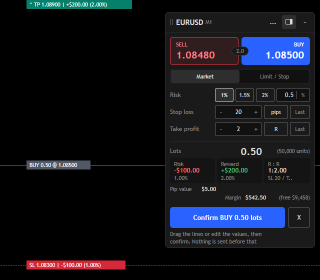

# MetaTrader 5 Modern Style

[](https://github.com/deaguss/metatrade-5-modern-style/actions/workflows/checks.yml)
[](LICENSE)

A clean, modern look for **MetaTrader 5 desktop** (Windows), and a risk-based order ticket that sits
right on your chart.



## What you get

- **ActionInna order ticket** (an Expert Advisor). Pick your risk (1%, 1.5%, 2% or your own), set the
  stop loss and take profit, and it works out the lot size for you. Press BUY or SELL to see the
  order on the chart first: entry, stop loss and take profit lines with the money at each. Drag the
  lines to adjust. **Nothing is sent until you press Confirm.** Put the ticket anywhere on the chart,
  or dock it to the right edge.
- **ModernStyle script**. One click gives your chart a modern look: a near-black background, white
  and blue candles, no grid, and a price scale you can drag. It saves the look as a template, so any
  chart can use it.
-  **InnaChart**. A roomy, modern chart that sits right on MetaTrader 5's chart area and opens
  with it, with MetaTrader 5's own candles: drawing tools with a floating toolbar, long and short
  positions that work out your lots, your own drawing and chart templates, and a network indicator
  in milliseconds. Trade from it too: its order ticket goes through the ActionInna EA, with the same
  preview and Confirm. See [docs/innachart.md](docs/innachart.md).
- **A tidy window layout**. A short guide to a clean MetaTrader 5 window, and to the drawing tools
  MetaTrader 5 already has, free and without limits: [docs/layout.md](docs/layout.md).

Everything runs on your PC, with MetaTrader 5's own prices and order execution. Nothing is sent over
the internet by these programs.

## Install (about 5 minutes, no coding)

You need **MetaTrader 5 for Windows**, opened at least once. Use a **demo account** first.

1. **Download.** On this page, click the green **Code** button, then **Download ZIP**. Open the ZIP
   and extract it to a folder, for example `Downloads\metatrade-5-modern-style`.
2. **Install.** In that folder, double-click **install.bat**.
   - If Windows says "Windows protected your PC", click **More info**, then **Run anyway**.
   - It finds every MetaTrader 5 on your PC, copies the programs into it and compiles them. Then it
     installs InnaChart and asks whether it should start with Windows: press **Y** and
     Enter. It ends with **Done** and the next steps. Press any key to close the window.
3. **Refresh MetaTrader 5.** Open the **Navigator** (`Ctrl+N`), right-click **Expert Advisors** and
   choose **Refresh**. (Or simply restart MetaTrader 5.)
4. **Turn on Algo Trading.** Click the **Algo Trading** button in the toolbar, so it turns green.
5. **Add the ticket.** In the Navigator, open **Expert Advisors > ActionInna** and drag **ActionInna**
   onto a chart. In the window that opens, check that **Allow Algo Trading** is ticked (Common tab),
   then press **OK**. The ticket appears on the chart.
6. **Add the look (optional).** Drag **Scripts > ActionInna > ModernStyle** onto the chart and press
   **OK**. To give every open chart the look, set **Apply to every open chart** to `true` first.
7. **Turn on InnaChart (once).** In the Navigator, right-click **Services** and choose
   **Refresh**; right-click **Services** again, choose **Add Service**, pick **InnaChart** and
   press **OK**. The screen fills MetaTrader 5's chart area with its own candles. From then on it
   opens with MetaTrader 5. The **MT5** button at its top right (or `Ctrl+Alt+M`) hides and shows it.

MetaTrader 5 allows one Expert Advisor per chart, so use a chart without another one on it.

<details>
<summary><b>Install by hand</b> (if install.bat cannot run on your PC)</summary>

1. In MetaTrader 5, choose **File > Open Data Folder**. A folder opens; go into `MQL5`.
2. From the downloaded folder, copy:
   - `mql5\Experts\ActionInna` into `MQL5\Experts`
   - `mql5\Include\ActionInna` into `MQL5\Include`
   - `mql5\Scripts\ActionInna` into `MQL5\Scripts`
3. In MetaTrader 5, press `F4` to open MetaEditor. Open `Experts\ActionInna\ActionInna.mq5` and press
   `F7` (Compile). Do the same for `Scripts\ActionInna\ModernStyle.mq5`.
4. Continue with step 3 above.

</details>

**Update:** download the new ZIP and run `install.bat` again. Then remove the ticket from the chart and
add it again (or restart MetaTrader 5), so the chart runs the new version. Your settings are kept.

**Uninstall:** remove the ticket from your charts, then double-click `uninstall.bat`. It lists what it
will delete and asks first.

## Using the ticket

1. **Pick the risk.** Press 1%, 1.5% or 2%, or type your own in the last box. The small button in
   that box switches it between %, money and lots.
2. **Set the stop loss.** Type it in pips, or use **–** and **+** (5 pips at a time). The `pips`
   button switches to a price. **Last** brings back the stop you used before on this symbol.
3. **Set the take profit**: `R` (2 means twice the stop distance), `pips` or `price`.
4. Press **BUY** or **SELL**. The order appears on the chart as lines with price tags showing pips,
   money and %. Drag any line, or change the boxes: the lot size and every number follow.
5. Press **Confirm**. Press **X** or `Esc` to close the preview without sending anything.

**Pending orders.** Press **Limit / Stop** (next to **Market**), then set the entry price, or simply
drag the entry line away from the price. The order type follows from where you put it:

| Side | Entry below the price | Entry above the price |
|---|---|---|
| Buy | Buy Limit | Buy Stop |
| Sell | Sell Stop | Sell Limit |

**A roomy chart.** While you are not trading, the ticket is one small row (SELL, risk, BUY) at the
top left, and the chart is not shifted. Press BUY or SELL and the full ticket opens with the preview;
after Confirm or Cancel it folds again. The `+` button keeps the ticket open; `–` (or the `H` key)
lets it fold again.

**Moving the ticket.** Drag it by its top bar (the six dots and the symbol) and drop it anywhere.
Near an edge, or near its place at the right, it snaps there. The window button in the top bar docks
it to the right edge (the chart then shifts to keep the newest candles clear of it) or lets it float.

**Changing open trades.** Drag the stop loss, take profit or entry line of an open trade. A card
opens with the new levels and the money at each. Nothing changes until you press **Confirm change**.

**The `...` menu** has: set SL/TP automatically from your last trade, one-click trading (sends at
once, without a preview: be careful), whether risk % is measured on equity or balance, **Pin to new
charts** (every new chart opens with the ticket) and **Save template**.

### Hotkeys

Click the chart once so it has the keyboard.

| Key | Action |
|---|---|
| `B` / `S` | Preview buy / sell (press again to close) |
| `1` / `2` / `3` / `4` | Risk preset 1, 2, 3, or your own risk |
| `Enter` | Confirm |
| `Esc` | Close the preview |
| `R` | Bring back earlier SL/TP (press again for older ones) |
| `P` | Switch Market / Limit-Stop |
| `H` | Fold / unfold the ticket |
| `Tab` / `Shift+Tab` | Move through every control; `Enter` or `Space` presses it |

Every key can be changed in the ticket's inputs (for example `SHIFT+B` or `F5`), or switched off.

## The modern chart style

The **ModernStyle** script sets the chart's colours and display, and asks a few questions first:

| Input | What it does | Default |
|---|---|---|
| Apply to every open chart | All open charts, not only this one | false |
| Let the chart be dragged up and down | MetaTrader 5's "Scale fix": drag the chart freely in every direction | true |
| Scroll to the newest candle on every tick | MetaTrader 5's "Chart autoscroll" | true |
| Show tick volumes | Volume bars under the candles | false |
| Save the style as this template | Then right-click any chart > **Templates** > **ModernStyle** | ModernStyle |

To go back, right-click the chart > **Templates** > **Default**, or set the colours in the chart's
properties (`F8`).

## Settings

Click the chart that has the ticket and press `F7` (the Expert Advisor's properties), then open the
**Inputs** tab. The main ones:

| Group | Input | Default |
|---|---|---|
| Risk | Risk presets | 1%, 1.5%, 2% |
| | Risk % is measured on | Equity |
| | Safety cap: block orders risking more than | 5% |
| | Commission per lot, round turn | 0 |
| Stop loss and take profit | Require a stop loss / take profit | on / on |
| | Default stop loss | 20 pips |
| | Default take profit | 2 R |
| | Set SL/TP from your last trade on the symbol | on |
| Execution | One-click trading (no preview) | off |
| | Magic number | 0 (counts as a manual trade) |
| | Drag open trades with a confirm card | on |
| Display | Hide MetaTrader 5's One-Click panel | on |
| | Shift the chart so the ticket covers no candles | on |
| | Theme | Auto (follows the chart background) |
| | Panel scale | 1.0 (follows the Windows display scale) |
| | Font / size | Trebuchet MS 9 |
| | Write a log to `MQL5\Files\ActionInna\log.txt` | on |

The "Browser panel" input is for a separate companion program that is not part of this project. You
can leave it as it is: without that program it does nothing.

Your choices on the ticket (risk, custom values, position) are saved in
`Common\Files\ActionInna\settings.txt` and come back next time.

## Troubleshooting

| Message or symptom | What to do |
|---|---|
| install.bat: "No MetaTrader 5 was found" | Open MetaTrader 5 once, close it, run install.bat again |
| install.bat: "MetaEditor was not found" or "could not compile" | Follow **Install by hand** above |
| ActionInna is not in the Navigator | Right-click **Expert Advisors** > **Refresh**, or restart MetaTrader 5 |
| "Turn on Algo Trading" on the ticket | Click the **Algo Trading** button in the toolbar |
| "Tick 'Allow Algo Trading'" | Click the chart, press `F7`, open the **Common** tab and tick **Allow Algo Trading** |
| Not sent: Market is closed | The symbol's trading session is closed |
| Not sent: Invalid SL or TP / too close | Move the line further away: the broker has a minimum distance |
| Min lot would risk ... | The stop is too wide for the risk: tighten it, raise the risk, or use lots |
| The ticket is too small or too large | Input **Panel scale** |
| The One-Click panel is gone after a crash | Right-click the chart > One Click Trading (`Alt+T`) |
| MetaTrader 5's own trade lines are gone | The ticket draws its own while it runs; they come back when it is removed. After a crash: `F8` > Show > Show trade levels |
| Still running the old version after an update | Remove the ticket from the chart and add it again, or restart MetaTrader 5 |
| InnaChart says "Waiting for MetaTrader 5" | Add the InnaChart service (step 7 above); more in [docs/innachart.md](docs/innachart.md#troubleshooting) |
| Anything else | The log, `MQL5\Files\ActionInna\log.txt` (File > Open Data Folder) |

## Safety

- Try everything on a **demo account** first.
- With one-click trading off (the default), nothing is sent until you press Confirm.
- InnaChart's order ticket sends nothing by itself: the ActionInna EA in MetaTrader 5 previews every
  order, change and close, and acts only when you press Confirm on a fresh preview, checking it all
  again first. InnaChart talks to MetaTrader 5 on the same PC only (127.0.0.1), with keys made each
  time it starts.
- Trading carries risk. This software comes with **no warranty** (see the [licence](LICENSE)); check
  every order before you confirm it.

## For developers

```text
mql5/
  Experts/ActionInna/ActionInna.mq5   the Expert Advisor: inputs and events
  Include/ActionInna/                 the ticket (Panel, Ui), risk and lots (RiskCalc), orders
                                      (Executor), chart lines (PreviewLines, OrderLines), memory
  Scripts/ActionInna/                 ModernStyle, and ActionInnaTests with its scenario suites
  Services/InnaChart/              InnaChart's feed (Include/InnaChart holds its code)
screen/
  host/                               InnaChart.exe (C#): the pipe, the local web server, the glue
  web/                                InnaChart's page: chart, drawing tools, templates
  test/, tools/                       its tests (Node.js) and a stand-in feed for working without MT5
tests/native/                         the same code compiled with g++ against a fake terminal
scripts/                              install, uninstall, build and link-mt5 (developer set-up)
docs/                                 the layout guide and images
prototype/                            the browser prototype of the ticket and the chart style
```

- Build: `powershell -ExecutionPolicy Bypass -File scripts\build.ps1 -Tests` (needs MetaTrader 5).
- Tests without MetaTrader 5: `bash tests/native/run.sh` (Git Bash, Node.js, g++).
- InnaChart: `node --test screen/test/*.test.js`, and
  `powershell -ExecutionPolicy Bypass -File scripts\build-screen.ps1 -Tests` for InnaChart.exe.
  [CONTRIBUTING.md](CONTRIBUTING.md) shows how to run it with a stand-in feed.
- Look at the ticket without MetaTrader 5: `bash tests/native/preview.sh`, then open the pages in
  `tests/native/out/preview`.
- Design decisions and colour contrast: [DESIGN.md](DESIGN.md). How to contribute:
  [CONTRIBUTING.md](CONTRIBUTING.md).

## Licence

[MIT](LICENSE). MetaTrader is a trademark of MetaQuotes Ltd.; this project is not affiliated with it.
