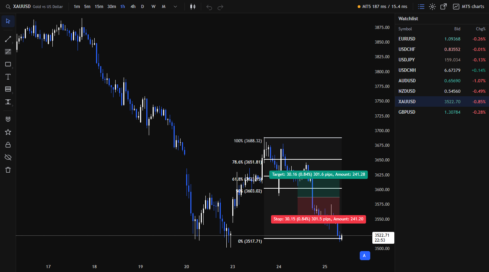

# InnaChart

A roomy, modern chart that sits on MetaTrader 5's chart area, with MetaTrader 5's own candles and
free drawing tools. MetaTrader 5 keeps running underneath: its menus, Market Watch and Toolbox stay
where they are.

## How it works

- **InnaChart** is a small *service* inside MetaTrader 5. It sends the terminal's bars and prices
  (the same bars as MetaTrader 5's charts, in the broker's server time) to InnaChart.exe.
- **InnaChart.exe** runs in the taskbar corner, by the clock. When MetaTrader 5 opens, it opens the
  screen on MetaTrader 5's chart area; the screen moves, resizes, minimises and closes with it. Or,
  if you prefer, as a window of its own that you place anywhere (it still opens and closes with
  MetaTrader 5).
- Everything stays on your PC. The screen talks to MetaTrader 5 on the same PC only.
- Its **order ticket** goes through the ActionInna EA on a chart in MetaTrader 5: the EA works out
  every number and sends nothing until you press Confirm (see [Trading](#trading)).

## Set up (once)

1. Run `install.bat` (see the [README](../README.md#install-about-5-minutes-no-coding)). It asks
   whether InnaChart should start with Windows: answer **Y**, so it is there whenever
   MetaTrader 5 opens.
2. In MetaTrader 5's **Navigator** (`Ctrl+N`), right-click **Services** and choose **Refresh**. Then
   right-click **Services** again, choose **Add Service**, pick **InnaChart** and press **OK**.

From then on, opening MetaTrader 5 is enough: the service starts with it, and the screen appears.

3. To trade from InnaChart, keep the ActionInna EA on one chart in MetaTrader 5 (its input **Serve
   InnaChart's order ticket** is on by default). One chart is enough for every symbol.

## Using it

| What | How |
|---|---|
| Change the symbol | Click the symbol at the top left, or simply start typing on the chart |
| Change the timeframe | The buttons at the top, the arrow next to them for all of them, or type a number on the chart (`15`, `60`, `240`) and press Enter |
| Move the chart | Drag it. Dragging up or down moves the prices too (auto scale turns off) |
| Zoom | Mouse wheel, or drag the time scale at the bottom |
| Stretch the prices | Drag the price scale; double-click it for auto scale again (or the **A** button) |
| Go back to the newest bar | The button at the bottom right, or double-click the time scale |
| Watchlist | The list icon at the top right. It starts with MetaTrader 5's Market Watch and is then your own: **+** adds a symbol, the **x** on a row (or Delete, or a right-click) removes it, drag a row to move it, the **...** menu adds sections. Click a column's title to sort by it. Click a row, or use the arrow keys, to open its chart. Drag the panel's left edge to make it wider or narrower |
| Hide the screen (MetaTrader 5's charts show) | The **MT5** button at the top right; `Ctrl+Alt+M` or the tray icon shows it again |
| A window of its own (to move it to another monitor, or maximise it) | The window button next to **MT5**, or the tray menu's **Separate window**. The same button glues it onto MetaTrader 5 again. The choice is remembered |

### Drawing

The tools are on the left: lines (trend line, ray, extended line, horizontal line and ray, vertical
line, parallel channel), Fibonacci retracement, shapes (rectangle, rotated rectangle, triangle, path,
arrow), text, long and short positions, and price and date ranges. The small arrow on a tool shows
the others in its group.

- Click where the drawing starts and click where it ends, or press, drag and let go.
- A path takes one click per point; double-click or press Enter to end it.
- Click a drawing to select it. Drag it to move it, drag a round handle to reshape it.
- The **floating toolbar** above a selected drawing changes its colours, line width and style, holds
  its templates and settings, locks it and removes it. Drag it by its dots to put it elsewhere.
- Right-click a drawing for more: clone, copy, bring to front, send to back, save as a template.
- Below the tools: the **magnet** (points snap to the open, high, low or close), **keep drawing**
  with the same tool, **lock** and **hide** every drawing, and **remove** every drawing.

Drawings are kept per symbol and show on every timeframe. Undo and redo with `Ctrl+Z` and `Ctrl+Y`.

### Long and short positions

Click where the entry is. The green zone is the target, the red zone the stop. Drag the handles on
the left to move the entry, the target or the stop, and the one on the right to change the width.

The box shows the distance, the % and the pips to the target and the stop, the money at each, the
risk : reward, and the **lots**: worked out from the risk (a % of the account size, or an amount of
money) with the symbol's own contract specification from MetaTrader 5, rounded down to the broker's
lot step. Open the settings (the gear on the floating toolbar) for the account size, the risk, the
prices, the colours and which numbers to show. **Use the account's equity** measures the risk on
your MetaTrader 5 account instead of a fixed size.

### Templates

- **Right-click a tool** on the left (or click its small arrow): under each tool are its saved
  templates. Pick one, for example a long position's "150 150", and click on the chart: the
  position is drawn with that template's risk, stop and target.
- **Right-click a drawing** for its templates too: picking one applies it to that drawing.
- A **drawing template** keeps a drawing's settings: open the template menu on the floating toolbar
  and choose **Save as a template**. A position template also keeps the distances of its stop and
  target, so applying it puts them at the same distance from the entry.
- **New drawings start from** a template you choose, per tool.
- A **chart template** keeps the chart's look: **Chart settings** (the gear at the top right) >
  **Template** > **Save as a template**.
- **Import templates** and **Export templates** (in the same menu, or right-click the chart) read and
  write all templates as one file, to move them to another PC or keep a copy.

### Chart settings

The gear at the top right: the candles' colours (body, borders, wick), the chart type (candles,
hollow candles, bars, line, area), what the top-left line shows, the scales' text and size, the last
price line and the countdown to the bar's close, bid and ask lines, the margins, the background (a
colour or a gradient), the grid, the crosshair and a watermark.

### Network and speed

The indicator at the top right shows, in milliseconds, MetaTrader 5's ping to your broker's server
and the round trip from the screen to MetaTrader 5 and back. Its dot is green, amber or red. Click it
for more: the round trip to InnaChart.exe, the time from a tick's arrival to its frame on screen,
how long one frame takes to draw, the age of the last tick, and the ticks a second.

## Trading

The **Trade** button at the top right shows the order ticket, a small window over the chart. Drag it
by its top bar to put it anywhere; double-click the top bar (or press its dock button) to put it at
the right edge. While you are not trading it folds to one row: SELL, your risk and lots, and BUY.
The **+** keeps it open.

1. **Pick the risk**: 1%, 1.5% or 2% (the EA's presets), or type your own in the box after them. The
   button inside that box switches it between %, lots and money. Under **Risk**, **of equity** says what the % counts
   from: press it to count from the balance instead (the ticket remembers your choice; until then
   it follows the EA's setting).
2. **Set the stop loss** in pips or as a price (**-** and **+** in the box move it by 5 pips; the
   button after the box changes the unit; **Last** brings back the one used before on the symbol,
   press again for older ones).
3. **Set the take profit**: R (2 is twice the stop), pips or a price.
4. Press **SELL** or **BUY** (the big buttons with the prices; the spread is between them).
   MetaTrader 5 works out the order and the lines appear on the chart: the entry, the stop loss and
   the take profit, with the money and pips at each. The ticket shows the lots, the risk, the reward,
   the risk : reward with the stop and target in pips, the pip value and the margin.
   Drag the lines to move them; the numbers follow.
5. Press **Confirm** (it says what it sends, for example "Confirm BUY 0.20 lots"). It works only on a
   fresh preview (a few seconds old at most); MetaTrader 5 checks everything again with the newest
   price before it sends. The **x** beside it, or `Esc`, closes the preview without sending anything.

**Pending orders.** Press **Limit / Stop** and set the entry, or drag the entry line. The order type
follows from where the entry is (a buy below the price is a Buy Limit, above it a Buy Stop).

**Open trades** of the chart's symbol show as dashed lines with their type, lots and profit, and the
money you lose at the stop loss and make at the take profit:

- drag a stop loss or take profit line (or a pending order's entry) to change it: a card shows the
  new levels and the money at each, from MetaTrader 5, and changes nothing until **Confirm change**;
- the **x** on a position closes it, all of it or the lots you type, after **Confirm close**; the **x**
  on a pending order removes it after you say yes.

The ticket shows **DEMO** or **REAL** for the account, and why it cannot send when something stops
it (Algo Trading off, MetaTrader 5 not connected). Every order, change and close is written to the
EA's log, `MQL5\Files\ActionInna\log.txt`.

## Where things are kept

| What | Where |
|---|---|
| Drawings, templates, the layout | `%APPDATA%\InnaChart` (a `.bak` copy of each file's previous version is kept) |
| The program | `%LOCALAPPDATA%\InnaChart\app` |
| Its log | `%LOCALAPPDATA%\InnaChart\host.log` |

The tray icon's menu opens the saved files folder.

## Troubleshooting

| What you see | What to do |
|---|---|
| The ticket says "put the ActionInna EA on a chart" | Drag Expert Advisors > ActionInna onto a chart (Algo Trading on, input **Serve InnaChart's order ticket** on) |
| "Waiting for MetaTrader 5" | Add the InnaChart service (Set up, step 2). In the Navigator, Services > InnaChart must not show as stopped |
| The screen does not open with MetaTrader 5 | Is the tray icon there? If not, start **InnaChart** from `%LOCALAPPDATA%\InnaChart\app`, and run `install.bat` again to let it start with Windows |
| The screen was closed by mistake | Click the tray icon, or press `Ctrl+Alt+M` |
| "Neither Microsoft Edge nor Google Chrome was found" | The screen is shown in an Edge (or Chrome) app window: install either |
| The broker ping is red | Your link to the broker is slow; the screen shows MetaTrader 5's own number |

## Remove it

`uninstall.bat` removes it with the rest (it asks first). Your drawings and templates stay in
`%APPDATA%\InnaChart` until you delete that folder.
