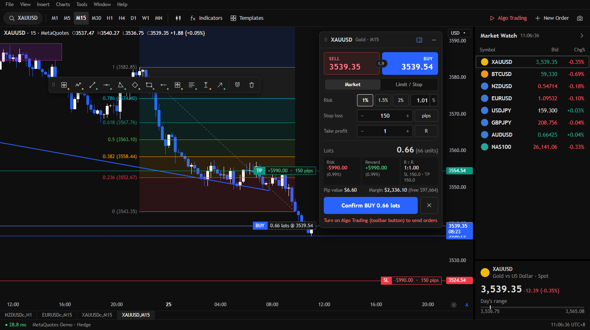

# A clean MetaTrader 5 window

MetaTrader 5 opens with a lot around the chart: the Market Watch and Navigator on the left, the
Toolbox at the bottom, and several toolbars. A few clicks give the chart most of the screen, in the
modern style. Nothing here needs code, and every step can be undone.

## 1. Give the chart the room

| Do this | How |
|---|---|
| Move the Market Watch to the right | Drag its title bar to the right edge of the window until a docking guide shows, and drop it there |
| Hide the Navigator | `Ctrl+N` (press again to show it; you need it to add programs to a chart) |
| Hide the Toolbox (Trade, History, Journal ...) | `Ctrl+T` |
| Hide or show the Market Watch | `Ctrl+M` |
| Keep one toolbar | **View > Toolbars**: untick the ones you don't use. Right-click a toolbar > **Customize** to choose its buttons |
| Float the drawing tools over the chart | Drag the drawing toolbar by its handle (the dotted edge) off the top bar and drop it on the chart |
| Full screen, chart only | `F11` (again to return) |

Save the whole arrangement with **File > Profiles > Save As**, so you can bring it back in one click.

## 2. The chart's look

Run the **ModernStyle** script (README, "The modern chart style"), or set it by hand in the chart's
properties (`F8`):

| Tab | Setting | Modern style |
|---|---|---|
| Colors | Background | `15,15,15` (near black) |
| | Foreground (scale text) | `178,181,190` |
| | Bar up, Bull candle | white |
| | Bar down, Bear candle | `41,98,255` (blue) |
| | Bid line | `41,98,255` |
| Show | Grid | off (`Ctrl+G`) |
| | Show OHLC | on |
| | Show Bid price line | on; Ask line off |
| Common | Scale fix | on: drag the chart up and down freely |
| | Chart autoscroll | on to follow the newest candle; off to look back in peace |
| | Chart shift | on: room right of the last candle |

Save it with right-click on the chart > **Templates > Save Template**. To make every new chart open
like this, save it with the name `default`.

## 3. Moving around the chart

| Action | How |
|---|---|
| Scroll back and forth | Drag the chart, or the mouse wheel |
| Zoom in / out | `+` / `-` |
| Stretch the price scale | Drag the price scale up or down (with Scale fix on, the chart then moves freely) |
| Candles / bars / line | `Alt+2` / `Alt+1` / `Alt+3` |
| Crosshair, and measuring a move | Click the mouse wheel (or `Ctrl+F`), then drag: it shows the bars, the points and the price between the two places |
| Back to the newest candle | `End` |

## 4. Drawing your analysis

MetaTrader 5 has its drawing tools built in, free and without a limit on how many you draw. They are
on the drawing toolbar and in **Insert > Objects**.

| You want | MetaTrader 5 tool |
|---|---|
| Trend line | **Trendline** |
| Horizontal level | **Horizontal Line** |
| Horizontal ray from a point | **Trendline**, drawn level, with **Ray right** ticked in its properties |
| Vertical line | **Vertical Line** |
| Arrow line | **Arrowed Line** |
| Zone / box | **Rectangle** (tick **Fill** in its properties for a solid zone) |
| Triangle | **Triangle** |
| Channel | **Equidistant Channel**, **Standard Deviation Channel**, **Regression Channel** |
| Fibonacci | **Fibonacci Retracement**, **Expansion**, **Fan**, **Arcs**, **Time Zones**, **Channel** |
| Pitchfork | **Andrews' Pitchfork** |
| Text and labels | **Text**, **Text Label**, **Arrows** |
| Measure a price range | The crosshair (click the mouse wheel and drag) |

Tips:

- **Snap to candles.** The **Magnet sensitivity** setting in **Tools > Options** sets how close (in
  pixels) a point must be to a candle's open, high, low or close to snap to it.
- **Fibonacci levels.** Double-click the Fibonacci object, then **Properties > Levels**, to set the
  levels and give each its own colour.
- **Modern colours for drawings.** Blue `41,98,255` for lines, red `242,54,69` and green `8,153,129`
  for levels against and for you, purple `156,39,176` for zones.
- **Your drawings stay.** MetaTrader 5 saves them with the chart, and with a template or profile.

## 5. The order ticket

Add the ActionInna ticket (README, "Install"). Drag it anywhere by its top bar: it snaps to the edges
and back to the right. With the window button it docks to the right edge, and the chart shifts so it
covers no candles.
